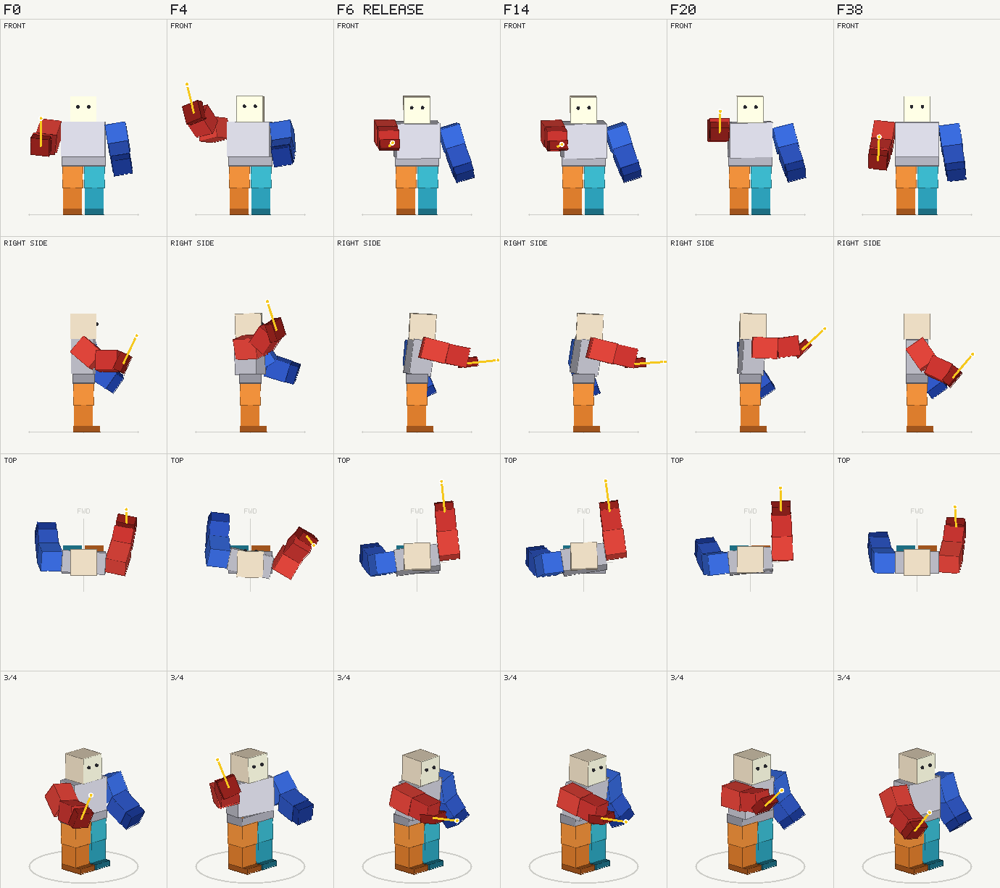

# roblox-anim-forge

Roblox R15 animations written as code. A spec is a few poses in degrees, as plain Luau data; the forge
turns it into a `KeyframeSequence` (`.rbxm`), checks it, draws it into a PNG contact sheet, and can
publish it through Open Cloud.

It was made for AI agents, which cannot watch an animation play but can read a picture and numbers,
and works just as well by hand: every pose is a commented line, easy to tweak to the degree.



## What it does

- **Build**: eased keys (Roblox's cubic curves) or one continuous curve through every key (`flow`),
  overlap between body parts, markers, loops. Upper body or whole body, the pelvis free to move.
- **Check**: a line per key with where the held item points and the heights of the pelvis, head,
  knees, ankles and wrists; validation of the spec (unknown joints, keys out of order, an unfinished
  loop...).
- **Preview**: a PNG with four views of each key (front, side, top, three-quarter), flagging limbs
  sunk into each other or under the ground. `--sweep` checks every frame in between.
- **Publish**: Open Cloud upload, for a group or a user.

## Install

Needs [Lune](https://github.com/lune-org/lune) 0.10.x. With [Rokit](https://github.com/rojo-rbx/rokit):
`rokit add lune-org/lune@0.10.5`.

In your project:

```bash
git submodule add https://github.com/Volubal/roblox-anim-forge tools/anim-forge
mkdir -p tools/animations/specs
cp tools/anim-forge/templates/anim.luau tools/animations/anim.luau
```

Edit the paths at the bottom of `tools/animations/anim.luau` if your layout differs, write a spec in
`tools/animations/specs/`, then:

```bash
lune run tools/animations/anim build
lune run tools/animations/anim preview MyAnimation
```

Try it on the examples first, from this repository: `lune run examples/anim build`, then
`lune run examples/anim preview Strike`.

## Commands

| Command | Does |
| --- | --- |
| `list` | The specs the runner knows. |
| `build [Name]` | Every spec (or one) into `<output>/<Name>.rbxm`, and all of them in `<output>/<bundle>.rbxm`. |
| `preview Name [frame ...]` | `<previews>/<Name>.png`: the keys, or the frames given (a frame between keys is marked `~`). |
| `preview Name --sweep` | Checks every frame, prints only the wrong ones. |
| `publish Name ...` | Uploads the built `.rbxm` files, prints their `rbxassetid://`. Needs `ROBLOX_API_KEY` and `ROBLOX_GROUP_ID` or `ROBLOX_USER_ID` in the environment. |

## Writing a spec

See [reference/spec.md](reference/spec.md): fields, joints and their axes, eased and flowing timing,
overlap. The [examples](examples/specs) cover an upper-body strike with a marker, a hit reaction, a
flowing whole-body gather with overlap, a kneel, and a looping dance.

The `Gather` example's sweep flags its right shin dipping 0.13 studs under the ground between two
keys: left in to show what the sweep catches, and a good first exercise.

## As a skill for AI agents

[SKILL.md](SKILL.md) teaches an agent the workflow: write the spec, build, look at the PNG, sweep,
iterate. For Claude Code, clone this repository into your skills folder:

```bash
git clone https://github.com/Volubal/roblox-anim-forge ~/.claude/skills/roblox-anim-forge
```

Other agents can be pointed at `SKILL.md` directly.

## Layout

- `src/`: the library. `forge.luau` (commands), `build.luau` (spec to `KeyframeSequence`), `rig.luau`
  (the R15 rig's geometry), `preview.luau` (the contact sheet and the checks), `canvas.luau` (a tiny
  rasterizer writing PNG), `publish.luau` (Open Cloud).
- `templates/anim.luau`: the runner to copy into a project.
- `examples/`: a runner and five specs.
- `scripts/check.sh`: what the CI runs (formatting, lint, the examples built and drawn).

## License

MIT with the Commons Clause: see [LICENSE](LICENSE). You may use, copy, modify and share the forge,
including in commercial projects (a paid game using animations made with it is fine), but you may not
sell the forge itself, or a product or service whose value comes mainly from it. The animations you
make with it are yours.
